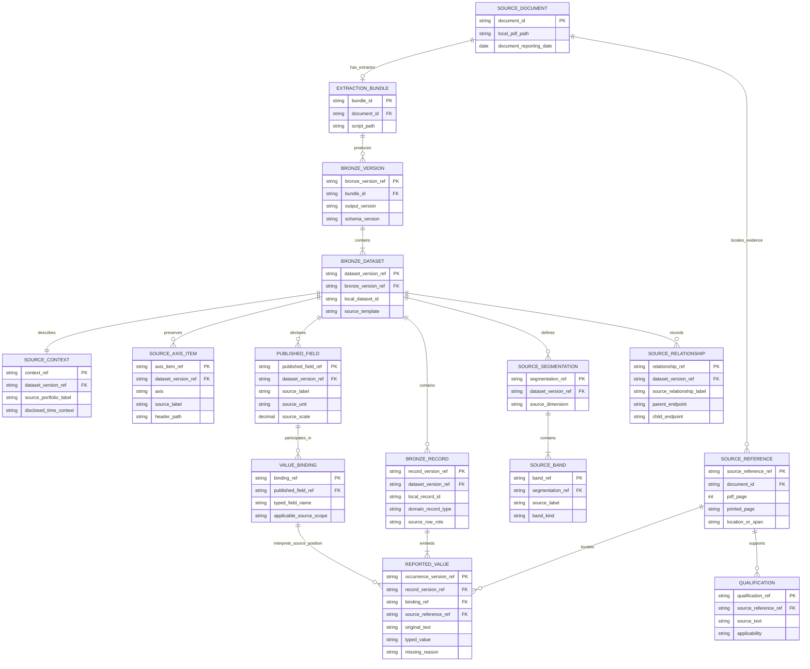
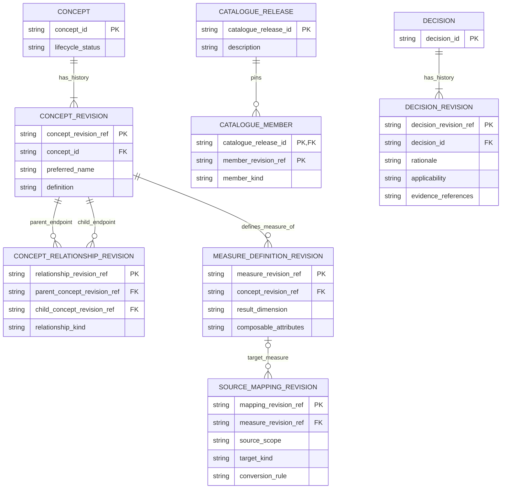
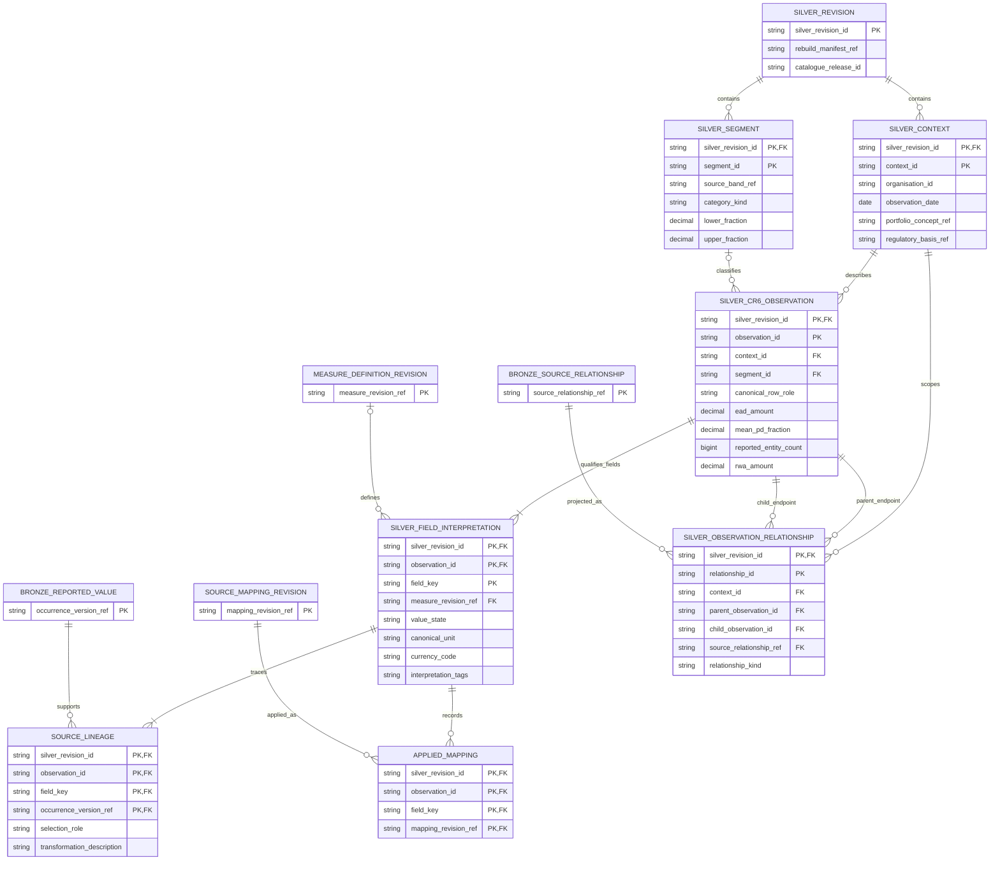

# Layered data model: E–R diagrams and Bronze/Silver contracts

Date: 2026-10-10

Status: Proposed logical schema for review; not implemented database DDL.

Companion to the [consolidated specification](2026-10-10-initial-data-model.md) and [worked source examples](2026-10-10-data-model-worked-examples.md). This document makes the layer ownership, entity relationships and first Silver domain contract explicit.

Feasibility evidence: [CBA/Westpac Mountainash and DuckDB spike](../../../00.ideation/2026-10-10-layered-model-feasibility-spike.md), including Decimal conformance findings and rebuild/publication checks. This is a throwaway experiment, not implementation of these contracts.

Implementation proposal: [First CR6 Bronze-to-Silver plan](../plans/2026-10-10-cr6-bronze-to-silver.md), awaiting review before execution.

The researcher expanded the planned initial extraction scope to the Australian mortgage CR6 blocks from CBA June 2025 and Westpac, NAB and ANZ September 2025. NAB/ANZ add source-backed counting, exposure-basis, overlay, entity/perimeter and missingness cases; the CBA/Westpac-only spike does not establish those new extractors or mappings.

The implementation plan ends with recreation of each selected table from saved Bronze and persisted Silver alongside its source-page images, followed by recorded visual reconciliation. Silver values are returned to source units for display; this review complements independent goldens and does not require exact accounting reconciliation.

## 1. Three models with different responsibilities

| Concern | Bronze: published evidence | Durable semantic catalogue | Silver: conformed observations |
|---|---|---|---|
| Grain | Selected source occurrence in a document/block/record/field | Versioned concept, definition, relationship or decision | Selected logical observation at an explicit analytical grain, within a Silver revision |
| Names | Published labels, row IDs and header paths | Stable canonical concepts and scoped source mappings | Canonical identifiers where established, with partial interpretation tags |
| Values | Parsed as reported; original text, sign, units and scale retained | No bank observation values required | Typed values in declared conformed units, with source lineage |
| Population | Source bands, source groups and disclosed scope | Reusable population/weighting/temporal definitions | Explicit selected population, mapped categories/bounds and known scope |
| Hierarchy | Published parent/subset/total relationships | Canonical concept relationships | Applied observation relationships retaining source relationship lineage |
| Missingness | Blank/dash and source-supported meaning | Rules and decisions about interpretation | Missing value versus unavailable conversion versus unresolved semantics distinguished |
| Corrections | New extraction output version | New definition/mapping/decision revision | Regenerated output revision |
| Authority | PDF and captured evidence | Source-backed knowledge and recorded researcher decisions | Reproducible application of selected inputs |

Silver may contain incomplete canonical metadata. A record is not rejected merely because a label has not yet been mapped. Bronze is already structured and typed, but its structure remains source-oriented; Silver does more than copy Bronze into DuckDB.

### E–R notation and scope

The diagrams are logical E–R models with representative attributes and cardinalities. They are not a commitment to one physical table per box. In particular, Bronze `ReportedValue` objects are embedded in typed records, and Silver financial values remain in typed domain tables rather than a universal entity–attribute–value store.

`PK` and `FK` identify logical keys/references. IDs ending in `_ref` are version-qualified references. Physical composite-key layouts and nested-file/tabular conversions must preserve these identities. Relationship lines show cardinalities; junction tables omitted from the catalogue overview are described explicitly below.

## 2. Bronze E–R: source-oriented capture



`typed_value` in the diagram denotes the generic `ReportedValue[T]` attribute, not a physical string-valued numeric column. CR6 records have twelve explicit value fields. Their occurrence keys identify record and field within a Bronze version. Absent source cells are represented by value/missingness state, not by deleting the selected field.

Bindings reference ordered row/column descriptors and applicable qualification IDs. Segment membership references source bands from the relevant record or field scope. These are explicit reference collections (or junction relations in a tabular representation), not label-based joins. `SourceRelationship` endpoints are tagged references to rows, fields or blocks, with scope and evidence; endpoint type determines which source key must resolve. A field-level relationship can apply across multiple records.

The diagram shows a primary source reference; additional supporting locations remain possible. A selected narrative amount has a paragraph/footnote reference and no invented row coordinates. A merged source amount has one occurrence and a source span, not one occurrence per covered column.

### Bronze CR6 contract

Name the source class **`BronzeCreditRiskExposureRow`** in layer-specific documentation/code. This is the earlier `CreditRiskExposureRow` with explicit ownership, not a change to its financial fields:

```text
record_id, source_row_ref, source_row_role
source_segment_memberships, source_aggregation_scope
on_balance_exposure: ReportedValue[Decimal]
off_balance_exposure: ReportedValue[Decimal]
average_ccf: ReportedValue[Decimal]
ead: ReportedValue[Decimal]
average_pd: ReportedValue[Decimal]
reported_borrower_count: ReportedValue[int]
average_lgd: ReportedValue[Decimal]
average_maturity: ReportedValue[Decimal]
rwa: ReportedValue[Decimal]
rwa_density: ReportedValue[Decimal]
regulatory_expected_loss: ReportedValue[Decimal]
provisions: ReportedValue[Decimal]
```

The source dataclass field names are convenient template-oriented identifiers. `reported_borrower_count` is not an assertion that the source counts distinct people or arrangements. Every field retains its source definition/binding.

## 3. Catalogue E–R: durable semantic knowledge



A catalogue release is an immutable selection of revision references, not copies of every definition. `member_kind` determines whether a member reference resolves to a concept, measure, relationship, decision or mapping revision. Each reusable member may occur in multiple releases. The release's reference closure also includes reused component definitions.

Measure attributes use typed values/references, including weight measure, population rules and time semantics; `composable_attributes` is an overview label, not a mandate for an opaque string column. A mapping can target a measure, role, category or partial tags. Its measure reference is optional when it targets something else or only establishes partial meaning.

Definitions, mappings and relationships can each cite multiple decision revisions and source qualifications; one decision/evidence item can support several definitions. Their support-reference collections are many-to-many associations. Source-effective date ranges are distinct from revision creation dates. Revisions and releases are stored durably outside regenerated Silver tables; a read-only catalogue projection in DuckDB is rebuildable.

## 4. Silver E–R: the conformed CR6 domain

The first Silver domain is **`SilverCreditRiskExposureObservation`**. Its grain is one selected disclosed portfolio/observation-date/PD-band or portfolio aggregate, with a stable identity based on selected source lineage. Mapped classifications describe the observation; they are not its sole identity key.



`BRONZE_REPORTED_VALUE`, `BRONZE_SOURCE_RELATIONSHIP`, `SOURCE_MAPPING_REVISION` and `MEASURE_DEFINITION_REVISION` are external references to the preceding models, not new authoritative Silver copies. Parent and child observation keys in a Silver relationship include its revision; referenced context/segment/field keys are likewise revision-qualified. These declarations do not authorize runtime referential checks: [validation is separate and undefined](../../../01.principles/c.extraction-and-validation/validation-is-a-separate-process.md). This diagram's relationships connect CR6 observations; another domain's relationship projection references its own typed observations and can additionally identify parent/child fields for column-level subsets.

The diagram abbreviates the wide CR6 numeric record. All twelve source measures have corresponding typed columns below. `SilverFieldInterpretation` supplies metadata and lineage for those columns, not their numeric storage. Common definitions remain shared through references; metadata need not duplicate the full definition per field.

### Silver record contract and units

| Silver field | Type | Meaning/convention |
|---|---|---|
| `silver_revision_id`, `observation_id` | ID | Composite observation key |
| `context_id` | Reference | Canonical/partially mapped portfolio, entity, date and scope |
| `segment_id` | Optional reference | Source-backed PD category/band; absent for an aggregate, with role/scope explicit |
| `canonical_row_role` | Optional category | Band detail or portfolio aggregate where mapped |
| `on_balance_amount`, `off_balance_amount` | Nullable Decimal | Monetary amount in base units of its identified or unresolved source currency |
| `mean_ccf_fraction` | Nullable Decimal | Percent-to-fraction conversion; values above 1 are permitted |
| `ead_amount` | Nullable Decimal | EAD, with its exposure basis carried by the field definition |
| `mean_pd_fraction` | Nullable Decimal | Mean PD as a fraction; weighting can remain partially understood |
| `reported_entity_count` | Nullable integer | Captured integral count; counted entity is tagged separately |
| `mean_lgd_fraction` | Nullable Decimal | Source average LGD as a fraction; no unsubstantiated upper bound of 1 |
| `mean_maturity_years` | Nullable Decimal | Source duration conformed to years where supported |
| `rwa_amount` | Nullable Decimal | Monetary RWA; overlay treatment remains tagged |
| `rwa_density_fraction` | Nullable Decimal | Density as a fraction; values above 1 are permitted |
| `regulatory_expected_loss_amount`, `provision_amount` | Nullable Decimal | Separate monetary concepts; preserve sign unless an explicit mapping selects a different convention |

Currency code and semantic definition are field metadata, not one implicit table-wide assumption. Multiplying an established `$M` source scale by one million does not establish an AUD code or perform FX conversion. Such an amount can be retained with unresolved currency. A field's unambiguous percent unit can be normalised even when its averaging convention is unknown.

Each represented field has a `value_state`: `present`, `source_missing` or `not_conformed`. The last means a source value exists but a required unit/representation conversion is not established. Its source value remains available through lineage; null canonical values never erase available evidence. Interpretation status/tags remain independent: a present percentage can have unresolved weighting. Whole-observation filtering based on one incomplete field is not the default.

`SilverContext` retains references to source context, mapped organisation/entity/portfolio/geography/regulatory definitions where available, and unresolved attributes. `SilverSegment` retains source band identity, canonical dimension where mapped, category kind, converted bounds and inclusivity/status. A default category and an aggregate are not synthetic numerical intervals. One source band is not equated with another merely because labels match.

### Other domain contracts

The same layer distinction applies as new extraction scopes are selected:

| Bronze capture record | Silver conformed record | Main conformance work |
|---|---|---|
| `BronzeCreditQualityRow` and allocation records | `SilverCreditQualityObservation` and allocation observations | Map asset/approach/category tags, standardise units and explicit sign conventions, preserve parent/subset links |
| `BronzeExposureMovementRecord` | `SilverExposureMovementObservation` | Map movement kind, resolve opening/closing/interval time roles, retain monetary units and signs |
| `BronzeFundingRequirementRecord` | `SilverFundingRequirementObservation` | Map funding item and regulatory weighting basis, resolve named/bounded maturity versus unsegmented scope |

These are proposed extension contracts, not mortgage records populated with unrelated nulls. Future domain records use their own context/grain requirements; they do not inherit CR6's one-band/snapshot assumptions. Their fields retain the same per-field definition/lineage contract.

## 5. Bronze-to-Silver examples

| Captured Bronze evidence | Conformed Silver representation |
|---|---|
| CBA June first-band PD `0.08`, `%`, first band `0.00 to <0.15` | `mean_pd_fraction = 0.0008`; band `[0, 0.0015)`; EAD-weighting reference from footnote 1 |
| Same row EAD `281,508`, `$M` | `ead_amount = 281508000000`; scale conversion recorded; currency code unresolved until independently established |
| Same row count `742,470`, label Number of borrowers | `reported_entity_count = 742470`; CBA's exact counted entity remains unresolved |
| Same row LGD `14`, `%` | `mean_lgd_fraction = 0.14`; present value with unresolved weighting |
| CBA `Sub-total` | Canonical portfolio-aggregate role, no individual band; source label and membership remain linked |
| Westpac CR1 allowance `(4,504)`, `$m` | Base amount `-4504000000` under a source-signed convention; positive magnitude only under an explicit selected conversion |
| NAB provision `501` and of-which `71`, `$m` | Separate amount observations with a preserved subset relationship; no generated `572` total |
| NAB LIQ2 merged unweighted total `221,248`, `$m` | One amount `221248000000`, unsegmented maturity scope and not-disclosed breakdown tag |

These examples define proposed conformance conventions. They do not assert that all source semantics have been resolved, or that these examples are implemented.

## 6. Rebuild and lineage consequences

Rebuilding selects Bronze versions plus an immutable catalogue/mapping selection and implementation/configuration versions. All Silver contexts, segments, domain rows, interpretation links and relationship projections are regenerated for a new Silver revision. The retained manifest sits outside the disposable output tables.

An observation can have more than one supporting source occurrence. Lineage distinguishes the selected value source from corroborating or comparative evidence; these are not summed merely because they support the same observation. Selection/deduplication decisions are deterministic rebuild inputs. Unknown equivalence leaves distinct source occurrences tagged rather than silently merged.

An interpretation correction changes mappings or catalogue revisions and can regenerate canonical roles, units or definition links while source evidence remains unchanged. A faithful Bronze fixture does not need rewriting for that correction. If new source notes are required, expand Bronze first. Retaining every historical Silver snapshot is optional; retaining the inputs needed to reproduce it is required.

This proposal is ready for model review, not yet for claiming implemented conformance. The next implementation plan must establish dataclass/table encodings, exact backend contracts and supported transactional publication without changing these layer boundaries implicitly.
